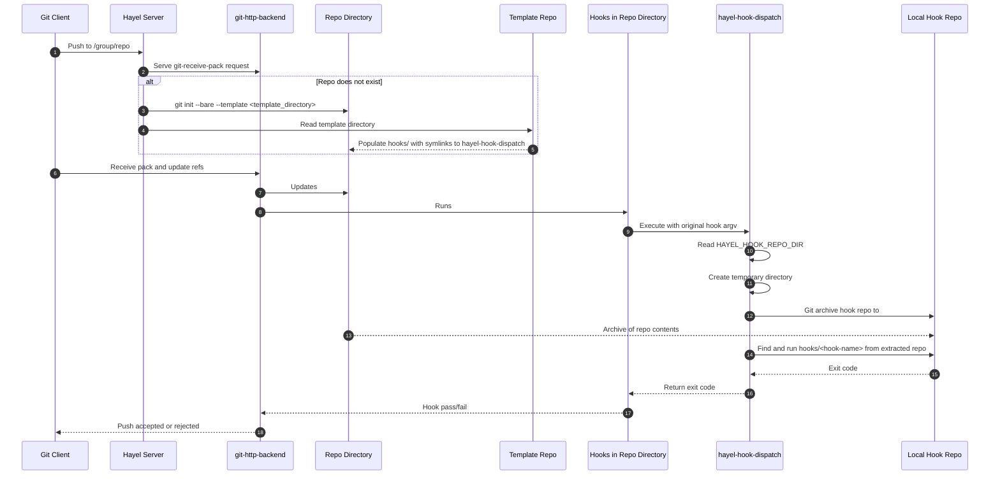

# Hayel 🐪

[](https://github.com/yamatt/hayel/actions/workflows/test.yml)
[](https://codecov.io/gh/yamatt/hayel)
[](https://github.com/yamatt/hayel/blob/main/go.mod)
[](https://github.com/yamatt/hayel/blob/main/LICENSE)
[](https://github.com/yamatt/hayel/releases/latest)
[](https://ghcr.io/yamatt/hayel)

Running your own single-user, serverless Git server focused on HTTPS and OIDC authentication.

It authenticates requests with OIDC and invokes Git's built-in `git-http-backend` to manage on-disk repositories over HTTP.

Any user successfully authenticated by the configured OIDC provider is authorized to use the server. Hayel does not maintain a separate local user allowlist.

Repositories are addressed by paths such as `/group/repo-name`. A bare repository is created automatically when the first push is received at that path. An authenticated `DELETE /group/repo-name` removes the repository and returns `204 No Content`.

An authenticated `GET /` returns JSON containing all repositories, for example `{"repositories":["group/repo-name"]}`.

The current configuration stores sessions in memory, so if the server restarts, it will have to re-verify the user, which can be slow.

## Running the server

Create or mount a directory containing bare repositories, then run:

```text
go run ./cmd/hayel-server
```

### Configuration

The server accepts configuration from a TOML file, `HAYEL_*` environment variables, or command-line flags. Sources are applied in this order, so later sources override earlier ones: defaults, TOML file, environment variables, then flags. Set `HAYEL_CONFIG` or pass `--config` to select a TOML file.

Example `hayel.toml`:

```toml
listen = ":8080"
repository_root = "/repositories"
template_directory = "/opt/hayel/template"
oidc_issuer = "https://issuer.example.com"
oidc_client_id = "hayel"
oidc_client_secret = "change-me"
oidc_redirect_url = "https://git-server.example.com/auth/callback"
```

The corresponding environment variables and command-line flags are:

- `HAYEL_LISTEN` / `--listen` (default `:8080`): Address for the Hayel gateway.
- `HAYEL_REPOSITORY_ROOT` / `--repository-root` (default `/repositories`):
  Directory containing bare Git repositories.
- `HAYEL_TEMPLATE_DIRECTORY` / `--template-directory` (default blank/off):
  Directory containing Git templates copied into each new repository. If unset, hook dispatch is disabled.
- `HAYEL_OIDC_ISSUER` / `--oidc-issuer` (default N/a): OIDC issuer URL.
- `HAYEL_OIDC_CLIENT_ID` / `--oidc-client-id` (default N/a): OIDC client ID.
- `HAYEL_OIDC_CLIENT_SECRET` / `--oidc-client-secret` (default N/a):
  OIDC client secret.
- `HAYEL_OIDC_REDIRECT_URL` / `--oidc-redirect-url` (default N/a):
  Registered callback URL, for example
  `https://git.example.com/auth/callback`.

### Hook dispatch templates

It is possible to specify programs to run as a git hook on the server based on a repo.

This would be useful if you want to setup a scalable CI pipeline.



The base hooks come from a template directory that is used when creating a new repo. These base hooks are symlinks to the hook dispatcher.

The dispatcher is provided an environment variable that tells it where the hook source repo is. The hook dispatcher archives that repository and runs the relevant hook program from the extracted snapshot.

That way you can update the hook source repo to change the hooks for all repos.

You need create the repo in Hayel that contains the hooks in the `hooks` directory and using the same name as the hook names.

Once you have pushed that repo to Hayel you need to provide Hook Dispatch the hooks repo directory by setting `HAYEL_HOOK_REPO_DIR`.

If you don't want to use this feature, leave `HAYEL_TEMPLATE_DIRECTORY`.

If you set `HAYEL_HOOK_REPO_DIR` before you have created a hook repo, it will block all future pushes until it is unset.

If `HAYEL_TEMPLATE_DIRECTORY` is unset when repos are pushed to Hayel, they will be missing the hooks and you will have to manually add them.

Note the hooks can access anything on the server.

## Configuring your local Git to authenticate to Hayel

You need to add an OIDC app to your IdP. The app will need Public Clients and PKCE.

You will need the Client ID to configure Git.

Then:

1. [You need git-credentials-oauth installed](https://github.com/hickford/git-credential-oauth).
1. Configure as follows:

```bash
git config --global credential.https://git-server.example.com.oauthClientId "CLIENT_ID"
git config --global credential.https://git-server.example.com.oauthScopes "openid profile email groups"

git config --global credential.https://git-server.example.com.oauthAuthURL "https://idp.exmaple.com/authorize"
git config --global credential.https://git-server.example.com.oauthTokenURL "https://idp.exmaple.com/api/oidc/token"
```

You should also configure Git to cache the tokens from your IdP so you're not opening your browser to authenticate on every push.

```bash
git config --global credential.https://git-server.example.com.helper "cache --timeout 28800" # in seconds (28800 is 8 hours)
git config --global --add credential.https://git-server.example.com.helper oauth
```
